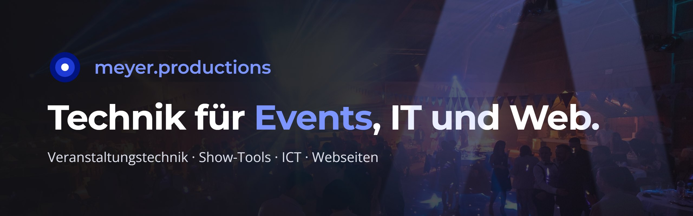

Ich mache Veranstaltungstechnik, baue mit AI eigene Show-Tools und kümmere mich um IT und Webseiten.

🌐 [meyer.productions](https://meyer.productions) · ✉️ [service@meyer.productions](mailto:service@meyer.productions) · 📍 Reigoldswil, Schweiz

## Was ich mache

- **Veranstaltungstechnik** – Licht, Ton und Video für Hochzeiten, Gottesdienste, Firmenanlässe und Open Airs: Planung, Umsetzung, Betreuung vor Ort und Schulung von Technik-Teams.
- **Companion & Show-Tools** – Alles mit einem Knopf steuern: eigene Module und Tools für Bitfocus Companion, Stream Deck und Planning Center.
- **ICT & IT-Support** – Netzwerk, WLAN, Telefonie und Microsoft 365.
- **Webseiten & Automation** – Webseiten und kleine Web-Apps, verbunden mit bestehenden Systemen.

## Eigene Tools

| Projekt | Beschreibung |
|---|---|
| [pi-streamer](https://github.com/meyer-productions/pi-streamer) | Ein Raspberry Pi nimmt Audio auf und schickt es per SRT an LiveVoice. Bedienung über eine einfache Webseite, auch vom iPad. |
| [companion-module-livevoice](https://github.com/meyer-productions/companion-module-livevoice) | Companion-Modul: steuert LiveVoice direkt über das Stream Deck. |
| [companionlistener](https://github.com/meyer-productions/companionlistener) | Startet Programme und Skripte auf einem Windows-PC per Knopfdruck am Stream Deck. |
| [companion-module-ubiquiti-unifi](https://github.com/meyer-productions/companion-module-ubiquiti-unifi) | Companion-Modul für UniFi Network über die offizielle, lokale Integration-API. |
| [karaoke-night-signup](https://github.com/meyer-productions/karaoke-night-signup) | Karaoke-App für Event-Abende: Anmeldung per Handy, Warteschlange auf der Leinwand, Steuerung per Stream Deck (inkl. Companion-Modul). |
| [planning-center-live](https://github.com/meyer-productions/planning-center-live) | Öffnet den nächsten Ablaufplan aus Planning Center Online automatisch im Vollbild. |

---

🇬🇧 English

### meyer.productions

**Technology for events, IT and web.**
Event technology, custom show tools built with AI, plus IT support and websites – by Fabian Meyer, Reigoldswil, Switzerland.

- **Event technology** – lighting, sound and video for weddings, church services, corporate events and open-air shows: planning, setup, on-site support and training for tech teams.
- **Companion & show tools** – control everything at the push of a button: custom modules and tools for Bitfocus Companion, Stream Deck and Planning Center.
- **ICT & IT support** – networks, Wi-Fi, telephony and Microsoft 365.
- **Websites & automation** – websites and small web apps, connected to existing systems.

The tools listed above are public on GitHub – issues and feedback are welcome.

🌐 [meyer.productions](https://meyer.productions) · ✉️ [service@meyer.productions](mailto:service@meyer.productions)

